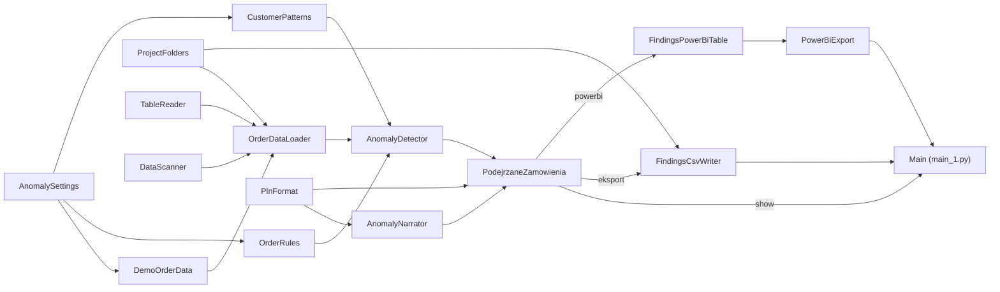

# Podejrzane zamówienia — które zamówienia warto sprawdzić?

Demonstracja automatycznego przeglądu **miliona zamówień hurtowni** w poszukiwaniu nieprawidłowości.
Program sam rozpoznaje strukturę danych (Data Scan), łączy zamówienia z klientami i produktami,
przepuszcza je przez zestaw reguł i pokazuje na interaktywnej stronie krótką listę zamówień
**do ręcznego sprawdzenia** — z powodami, szacowaną stratą i kontekstem.

Dla kogo: kontroling, dział sprzedaży, audyt wewnętrzny — wszędzie tam, gdzie trzeba szybko znaleźć
kilkadziesiąt nietypowych pozycji wśród milionów poprawnych.

Projekt jest zbudowany w CatNip — wizualnym edytorze Pythona opartym na blokach. Każdy blok to jedna
klasa w osobnym pliku `.py` z własną stroną dokumentacji `.md`.

> [!WARNING]
> **To jest projekt poglądowy (demonstracyjny), a nie narzędzie audytowe ani porada.**
> Dane w projekcie są w całości **fikcyjne** — generuje je program, a wszelkie podobieństwo do
> prawdziwych firm, klientów czy handlowców jest przypadkowe. Oznaczenie zamówienia przez program
> to jedynie **sygnał do ręcznej weryfikacji**, a nie dowód nadużycia, błędu ani winy konkretnej
> osoby. Wyniki nie stanowią porady prawnej, audytowej, finansowej ani inwestycyjnej. Jeśli
> uruchamiasz program na prawdziwych danych, odpowiadasz za zgodność ich przetwarzania z RODO
> i wewnętrznymi zasadami firmy. Autor nie ponosi odpowiedzialności za decyzje podjęte na podstawie
> wyników programu.

## Co wykrywa

**Reguły dla pojedynczego zamówienia** (wektorowo — milion wierszy w ułamku sekundy; normy liczone
odpornie, medianą i MAD, więc kilka złych zamówień nie przesuwa samej normy):

| Reguła | Kiedy zamówienie jest oznaczane |
|---|---|
| Cena poniżej kosztu | Cena netto po rabacie niższa niż koszt produktu. |
| Nietypowy rabat | Rabat wyższy od typowego dla segmentu klienta o więcej niż `discount_gap_pp`. |
| Nietypowa cena | Cena odbiega od typowej ceny produktu o więcej niż `price_z` odchyleń. |
| Nietypowa ilość | Ilość wielokrotnie większa od typowej dla produktu (`quantity_z`). |
| Poza godzinami | Noc (przed `night_end_hour`), od 22:00 albo niedziela. |
| Duplikat | To samo zamówienie powtórzone w ciągu `duplicate_minutes` minut. |

**Wzorce klientów:**

- **Nagła zmiana zachowania** — klient zamówił w ostatnim miesiącu `behaviour_ratio` razy więcej niż średnio.
- **„Klony”** — grupy klientów o niemal identycznym koszyku zakupów (podobieństwo cosinusowe ≥ `similarity`).

**Koncentracja u handlowców** — udział każdego handlowca w podejrzanych cenach i rabatach wobec jego
udziału we wszystkich zamówieniach.

## Co pokazuje strona

- KPI: ile zamówień przejrzano, ile jest do sprawdzenia, szacowana strata.
- Odpowiedź w kilku zdaniach: dlaczego te zamówienia i kto za nimi stoi.
- Trafienia każdej reguły, tabela zamówień z filtrem reguły i szczegółami klikniętego wiersza.
- Koncentracja u handlowców, klony i nagłe zmiany.
- Data Scan: rozpoznane tabele, typy kolumn, klucze, powiązania i czas każdego kroku pipeline'u.
- Przycisk **„Zapisz listę do CSV”** — zapisuje listę do `output/podejrzane_zamowienia_<data>.csv`
  w formacie dla polskiego Excela (średnik, przecinek dziesiętny, UTF-8 z BOM).
- Przycisk **„Eksportuj do Power BI”** — zapisuje tę samą listę do
  `output/powerbi/podejrzane_zamowienia.parquet` (patrz [Power BI](#power-bi)).

## Dane demonstracyjne

Przy pierwszym uruchomieniu blok `DemoOrderData` tworzy w `input/` hurtownię z 9 miesięcy 2026 r.:

| Plik | Zawartość |
|---|---|
| `orders.csv` | 1 000 000 zamówień (ok. 60 MB). |
| `customers.json` | 2 000 klientów w 5 segmentach. |
| `products.xlsx` | 300 produktów z ceną katalogową i kosztem. |

W danych celowo ukryto: 12 rabatów 35–45% (9 u jednego handlowca), 8 cen poniżej kosztu, 6 gigantycznych
ilości, 5 zamówień nocnych, 4 duplikaty, 3 nowych klientów kupujących identycznie i 2 klientów z nagłym
wzrostem zamówień we wrześniu. Generowanie jest deterministyczne (`seed`), więc na każdej maszynie
powstają te same dane. Pliki nie są przechowywane w repozytorium — tworzą się same w kilka sekund.

**Własne dane:** umieść w `input/` pliki `orders.csv`, `customers.json` i `products.xlsx` o tych samych
kolumnach — program użyje ich zamiast danych demonstracyjnych (generator działa tylko, gdy któregoś
pliku brakuje albo gdy `regenerate=True`). Folder `input/` jest wykluczony z gita, więc prawdziwe dane
nie trafią przypadkiem do repozytorium.

## Wymagania

- **Python 3.9 lub nowszy**.
- Pakiety z [`requirements.txt`](requirements.txt): `pandas`, `numpy`, `matplotlib`, `openpyxl`, `pyarrow`.
- **CatNip** — do wyświetlenia interaktywnej strony z wynikami.

Internet nie jest potrzebny.

## Instalacja

```bash
git clone <adres-repozytorium>
cd PodejrzaneZamowienia

python -m venv .venv
# Windows:
.venv\Scripts\activate
# Linux / macOS:
source .venv/bin/activate

pip install -r requirements.txt
```

## Uruchomienie

### W CatNip (zalecane)

1. Otwórz `PodejrzaneZamowienia.catnip` w CatNip.
2. Wybierz środowisko Pythona z zainstalowanymi pakietami (venv albo Docker).
3. Uruchom przepływ (Run). Strona pojawi się w zakładce **Output**; przycisk „Zapisz listę do CSV”
   działa, dopóki strona jest aktywna.

### Bez CatNip

```bash
python main_1.py
```

Dane się wygenerują i przegląd policzy się w całości, ale interaktywną stronę (i przycisk zapisu CSV)
obsługuje tylko Run Engine CatNip — poza nim zostanie wypisany jedynie komunikat, że strony nie ma
gdzie pokazać.

## Power BI

Przycisk **„Eksportuj do Power BI”** na stronie raportu zapisuje listę podejrzanych zamówień do pliku Parquet
`output/powerbi/podejrzane_zamowienia.parquet` (za każdym razem nadpisuje go najnowszymi danymi) i wypisuje
w konsoli jego pełną ścieżkę. Kolumna `Data` jest prawdziwą datą, a `Wyeksportowano` mówi, z kiedy jest eksport.

Podłączenie (raz):

1. Uruchom przepływ w CatNip (Code Run) i kliknij **Eksportuj do Power BI**. W konsoli pojawi się
   gotowe zapytanie Power Query ze ścieżką pliku na tym komputerze (także przy uruchomieniu w Dockerze).
2. W Power BI Desktop: *Pobierz dane → Puste zapytanie → Edytor zaawansowany*, zastąp treść tym
   zapytaniem (to samo jest w `output/powerbi/podejrzane_zamowienia.pq`) i kliknij *Gotowe*.

Nie wklejaj ścieżki w *Pobierz dane → Parquet → Adres URL* — to pole przyjmuje tylko adres w sieci.

Potem: kliknięcie przycisku w CatNip → **Odśwież** w Power BI. Usługa Power BI w chmurze nie widzi pliku
na tym komputerze bez bramy danych — do automatycznego odświeżania zapisuj plik do folderu OneDrive/SharePoint
(ustawienie `output_path` bloku `PowerBiExport`).

## Struktura projektu

Przepływ danych (GitHub wyświetla go jako diagram):



### Bloki, które wykonują pracę

| Blok | Do czego służy |
|---|---|
| `AnomalySettings` | Wszystkie progi reguł i parametry danych demonstracyjnych. |
| `ProjectFolders` | Folder projektu (z plikiem `.catnip`) oraz `input/` i `output/`; działa lokalnie i w Dockerze. |
| `TableReader` | Czyta CSV, JSON i Excel do `pandas.DataFrame`. |
| `DataScanner` | Data Scan: typy kolumn, braki, klucze tabel i powiązania między plikami. |
| `DemoOrderData` | Generuje dane demonstracyjne z ukrytymi nieprawidłowościami, gdy ich brak. |
| `OrderDataLoader` | Wczytuje pliki, robi Data Scan i łączy wszystko w jedną tabelę z ceną netto i wartością. |
| `OrderRules` | Reguły dla pojedynczego zamówienia (maski True/False dla wszystkich zamówień naraz). |
| `CustomerPatterns` | Reguły na poziomie klienta: nagła zmiana zachowania i „klony”. |
| `AnomalyDetector` | Uruchamia reguły, mierzy czas kroków i zbiera listę do sprawdzenia. |
| `PlnFormat` | Liczby i kwoty po polsku (spacja tysięcy, przecinek, zł / tys. zł / mln zł). |
| `AnomalyNarrator` | Zamienia wynik w kilka zdań odpowiedzi. |
| `PodejrzaneZamowienia` | Interaktywna strona raportu z akcjami `eksport` (CSV) i `powerbi` (Power BI). |
| `FindingsCsvWriter` | Zapisuje listę podejrzanych zamówień do CSV po kliknięciu przycisku. |
| `FindingsPowerBiTable` | Przygotowuje listę dla Power BI: data jako data, czas eksportu. |
| `PowerBiExport` | Zapisuje ją jako Parquet dla Power BI (atomowo, z zapytaniem `.pq` obok). |
| `Main` | Punkt wejścia; z niego CatNip generuje `main_1.py`. |

### Rekordy danych (`@dataclass`)

| Blok | Co przechowuje |
|---|---|
| `ColumnProfile` | Profil kolumny: typ, braki, liczba różnych wartości, klucz, powiązanie. |
| `TableProfile` | Profil pliku źródłowego: format, liczba wierszy, kolumny, klucz. |
| `PipelineStep` | Jeden krok przetwarzania i jego czas. |
| `DataScan` | Wynik Data Scan i lista kroków pipeline'u. |
| `OrderDataset` | Zamówienia połączone z klientami i produktami. |
| `AnomalyReport` | Wynik przeglądu: oznaczone zamówienia, trafienia reguł, klony, nagłe zmiany, handlowcy. |

Każdy blok ma swoją szczegółową dokumentację w pliku `<NazwaBloku>.md`.

### Pliki i foldery

| Ścieżka | Opis | W repozytorium |
|---|---|---|
| `PodejrzaneZamowienia.catnip` | Projekt CatNip (graf bloków). | tak |
| `*.py`, `*.md` | Kod i dokumentacja bloków; `main_1.py` — wygenerowany punkt wejścia. | tak |
| `requirements.txt` | Zależności Pythona. | tak |
| `input/` | Dane wejściowe — demonstracyjne (generowane) albo własne. | nie |
| `output/` | Zapisane listy CSV i plik dla Power BI (`output/powerbi/`). | nie |

## Konfiguracja

Progi ustawia się w inicjalizatorze bloku **`AnomalySettings`** (w CatNip: Inspektor → INITIALISER →
Refresh → zmień → Apply, albo w `AnomalySettings.py`):

| Parametr | Domyślnie | Zakres | Znaczenie |
|---|---|---|---|
| `n_orders` | `1000000` | ≥ 10 000 | Liczba zamówień w danych demonstracyjnych (przy generowaniu od nowa). |
| `regenerate` | `False` | `True`/`False` | `True` = wygeneruj dane demo od nowa, nawet jeśli są w `input/`. |
| `seed` | `42` | liczba całkowita | Ziarno losowania danych demo. |
| `price_z` | `6.0` | > 0 | Dopuszczalne odchylenie ceny (w odchyleniach MAD); mniej = więcej oznaczeń. |
| `quantity_z` | `5.0` | > 0 | To samo dla ilości, w skali logarytmicznej. |
| `discount_gap_pp` | `15.0` | ≥ 0 | O ile punktów rabat może przekroczyć typowy rabat segmentu. |
| `night_end_hour` | `6` | 0–23 | Zamówienia przed tą godziną (oraz od 22:00 i w niedziele) są nietypowe. |
| `duplicate_minutes` | `10` | ≥ 0 | Okno, w którym powtórzone zamówienie jest duplikatem. |
| `behaviour_ratio` | `4.0` | > 1 | Krotność średniej, od której wzrost zamówień jest nagłą zmianą. |
| `similarity` | `0.98` | (0, 1] | Podobieństwo koszyków, od którego klienci są „klonami”. |

Niższe progi oznaczają więcej zamówień do sprawdzenia (więcej fałszywych alarmów), wyższe — mniej
oznaczeń i ryzyko przeoczenia.

## Licencja

Licencja nie została jeszcze wybrana — do czasu dodania pliku `LICENSE` wszystkie prawa zastrzeżone.

## Zastrzeżenie

Projekt ma charakter wyłącznie **poglądowy i edukacyjny**. Dane są fikcyjne, a wyniki to sygnały do
weryfikacji, nie ustalenia. Projekt nie stanowi porady prawnej, audytowej, finansowej ani inwestycyjnej.
Wszelkie decyzje podejmujesz na własną odpowiedzialność.
